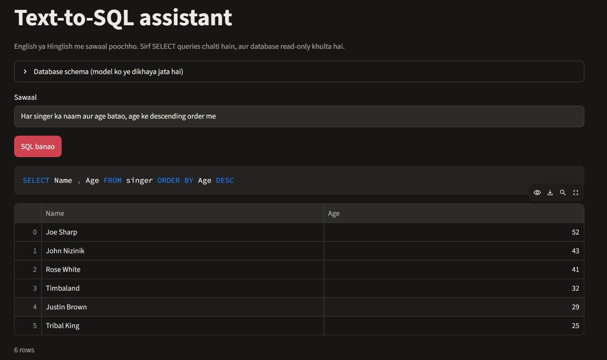

# Text-to-SQL for English and Hinglish (QLoRA fine-tuned Qwen2.5-Coder-3B)

Ask a question about a database in **English or Hinglish** ("Kitne singers hain?") and get a SQL query plus the result.
A 3B model fine-tuned with QLoRA on a single 8 GB laptop GPU (RTX 4060), served locally through Ollama, with a Streamlit demo.



## Results

All numbers use the same script, prompt and settings (`eval_hf.py`), so models are directly comparable.
Metric: **execution accuracy** on Spider dev (1,034 questions): the generated SQL must return the same rows, in the same column order, as the gold SQL. This is slightly stricter than the official Spider metric.

| Model | English exec. acc. | English valid SQL | Hinglish exec. acc. | Hinglish valid SQL |
|---|---|---|---|---|
| Base Qwen2.5-Coder-3B-Instruct | 62.3% | 85.7% | 46.5% | 78.5% |
| Fine-tuned, English data only | 72.2% | 95.1% | 55.5% | 93.5% |
| **Fine-tuned, English + 600 Hinglish** | 71.6% | 93.1% | **66.0%** | 93.5% |

- Hinglish test set: 200 Spider dev questions translated to Hinglish (LLM-assisted). Spider dev uses databases not seen in training.
- Adding 600 Hinglish training examples improved Hinglish accuracy by about 10 points. The English change (-0.7 pts) is within sampling noise (about +/-1.4 pts).
- Most of the first fine-tuning gain came from fewer invalid SQL outputs (about 148 to 56 on English dev); logic errors changed little. JOIN-heavy questions remain the weakest area.

## How it works

1. `prepare_data.py`: Spider train set to chat-format examples (schema as `CREATE TABLE` text + question, SQL as the answer).
2. `train_qlora.py`: 4-bit QLoRA with Unsloth, rank 16, 1 epoch (about 1 hour on an RTX 4060 8 GB, peak 2.5 GB GPU memory), loss on the answer only.
3. `make_hinglish.py`, `merge_hinglish_train.py`: Hinglish questions for testing and 600 for training.
4. `eval_hf.py`: execution-accuracy evaluation against the real SQLite databases.
5. `export_merged.py` + llama.cpp `convert_hf_to_gguf.py` + `Modelfile`: merge the adapter, convert to GGUF, load in Ollama.
6. `app.py` + `sql_utils.py`: Streamlit demo.

## Demo app

- Upload a SQLite file or CSV files (CSVs become tables in an in-memory database), or pick a Spider database.
- The schema is shown in the same format the model was trained on.
- **Safety:** only a single `SELECT`/`WITH` statement is allowed (checked before running), and the database is opened read-only, so even a bypassed check cannot write. Queries have a 10-second timeout and 200-row limit.
- Optional retry: if the SQL fails, the error is sent back to the model once.

```
pip install streamlit pandas
ollama create text2sql-hinglish -f Modelfile     # after placing the GGUF, see below
python -m streamlit run app.py
```

## Reproduce

```
python prepare_data.py
python train_qlora.py --model unsloth/Qwen2.5-Coder-3B-Instruct --train data/train_mixed.jsonl --val data/val.jsonl --out outputs/lora_sql_hinglish
python eval_hf.py --adapter outputs/lora_sql_hinglish --data data/dev.jsonl --db-dir spider/database --out results/ft.jsonl
python export_merged.py
python llama.cpp/convert_hf_to_gguf.py outputs/merged_hinglish --outfile outputs/text2sql-f16.gguf --outtype f16
ollama create text2sql-hinglish -f Modelfile
```

Model weights: https://huggingface.co/Krsna444/text2sql-hinglish-lora (LoRA adapter / merged model).

## Limitations (please read)

- Single run, single seed, 1 epoch. No variance estimate across seeds.
- Training and test Hinglish were produced the same way (LLM-assisted translation), so 66.0% may be optimistic for real users' writing. A small hand-written Hinglish set should be reported separately.
- Spider databases are small and clean; real-world schemas (hundreds of tables, ambiguous names) are harder.
- Execution accuracy can count a wrong query as correct if it happens to return the same rows.
- The Ollama model is the 16-bit GGUF (6.2 GB); a smaller quantized version was not evaluated.

## Credits and licenses

- Dataset: [Spider](https://yale-lily.github.io/spider) (Yu et al., 2018), CC BY-SA 4.0.
- Base model: Qwen2.5-Coder-3B-Instruct by Alibaba Qwen. Check the license on its model card before any commercial use.
- Training: [Unsloth](https://github.com/unslothai/unsloth). GGUF conversion: [llama.cpp](https://github.com/ggml-org/llama.cpp).
